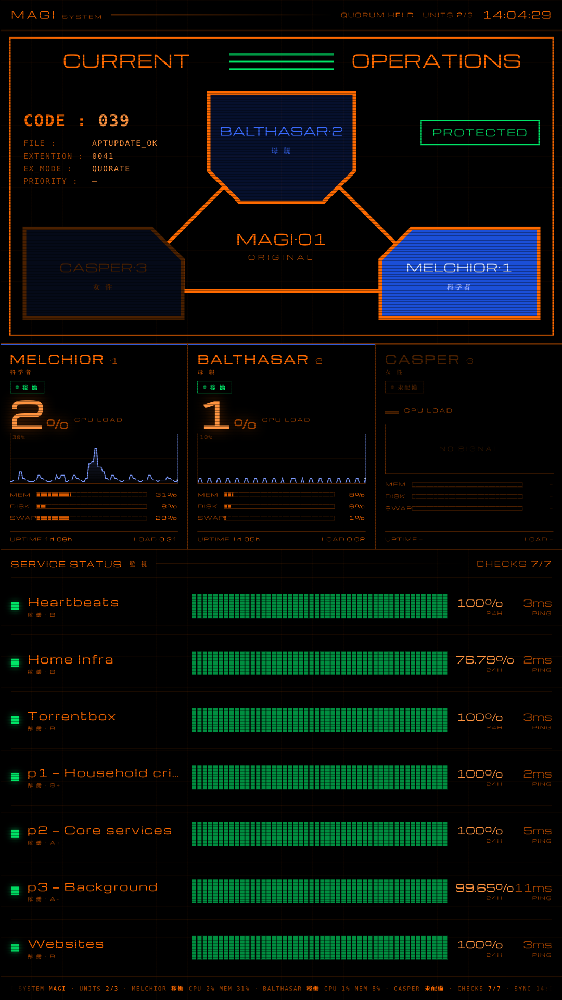
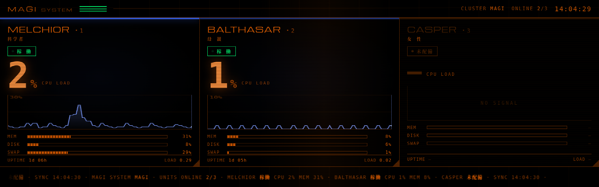

# magi-display

Evangelion MAGI-style status panels for a Proxmox VE cluster. Two of them: a wide bar for a rack
LCD, and a full-height console panel that also absorbs an Uptime Kuma status page.

Everything on screen is real data. There is no decorative text.



<sub>The console panel, 1080×1920, running fullscreen on a portrait monitor.</sub>



<sub>The rack panel, 1280×400, on an ultrawide bar LCD.</sub>

---

## What it does

A small Python collector polls the Proxmox cluster API with a **read-only** token and writes a
`data.json`. A self-contained HTML page (no build step, no framework, no dependencies) reads that
file every five seconds and draws it.

| Panel | Size | Shows |
|---|---|---|
| `display/index.html` | 1280×400 | Three node columns: CPU with a live history trace, memory, disk, swap, uptime, load |
| `display/console.html` | 1080×1920 | The MAGI trilobe schematic, the same three node columns, and a service-status section rendered from an Uptime Kuma status page |

The three units are keyed on **Proxmox node name**. A unit with no matching node in the cluster
renders dark and reads 未配備 *(not deployed)* — so if you name your nodes `melchior`, `balthasar`
and `casper`, the third lights up by itself the day it joins. No code change, no redeploy.

---

## Requirements

- A Proxmox VE cluster (single node works — the other units just sit dark)
- A Linux box with a browser to drive the screen. Both X11 and Wayland are fine; the panels are
  just a web page
- Python 3 (standard library only — no pip install)
- Optional: an Uptime Kuma instance with a **published** status page, for the console panel's
  service section

## Install

```bash
git clone https://github.com/angusmaul/magi-display
cd magi-display
./install.sh console     # or: ./install.sh rack
```

Then follow the four steps it prints: copy your cluster CA, fill in `/etc/magi/magi.env`, edit the
`UNITS` array to match your node names, and enable the two services.

### Create the read-only token first

```bash
pveum user token add root@pam magi-display --privsep 1
pveum acl modify / --tokens 'root@pam!magi-display' --roles PVEAuditor
```

`privsep 1` matters. Without it the token inherits root's full rights; with it, the panel can read
status and nothing else. It cannot start, stop or reconfigure anything, which is the entire point —
this box drives a screen.

TLS is verified fully, chain and hostname, against the cluster CA. **Don't "fix" a certificate error
by disabling verification** — that hands anyone on your LAN a MITM of the API token.

### Configuration

All of it lives in `/etc/magi/magi.env` (mode `0600`, root-owned; systemd reads it as root *before*
dropping privileges, so the service user can never read the secret off disk).

| Variable | Default | Notes |
|---|---|---|
| `PVE_HOST` | — | Any cluster node |
| `PVE_TOKEN_ID` / `PVE_TOKEN_SECRET` | — | The read-only token above |
| `PVE_CA` | `/etc/magi/pve-root-ca.pem` | Copy from `/etc/pve/pve-root-ca.pem` |
| `MAGI_INTERVAL` | `5` | Poll seconds |
| `MAGI_CLUSTER` | `MAGI` | Label in the header |
| `MAGI_EXTRA` | `0` | Console panel: guest counts + quorum. 2 extra calls per tick |
| `MAGI_KUMA_URL` | *(unset)* | Console panel: Uptime Kuma base URL. Unset disables the section |
| `MAGI_KUMA_SLUG` | `main` | Status page slug |
| `MAGI_GUEST_FS_WARN` | `80` | Percent at which a guest's rootfs is called out on its node's lobe |

Node names are the one thing not in the env file — edit the `UNITS` array at the top of the
`<script>` block in the page. **This is a wart, not a design**: it is configuration living in code,
in the one file `install.sh` overwrites, so a reinstall silently reverts your node names. Until it
moves into the env file, re-run `bin/magi-verify` after every install (see below) — it will show you
exactly that edit coming back as drift.

## Keeping a deployed panel honest

The panels are static files copied onto a box, and nothing stops anyone editing them in place. Doing
so is always the tempting move — fast, local, and safer-feeling than reinstalling over a working
display when you cannot see what you would be overwriting. That is how a screen ends up running code
that exists nowhere in git.

Two things make that visible rather than inevitable:

**`install.sh` stamps provenance.** It writes `$MAGI_HOME/INSTALLED` recording the commit the files
came from, whether the tree was dirty at the time, and when. A dirty tree is recorded loudly, because
it means the deployed bytes cannot be reproduced from the revision alone.

**`bin/magi-verify` compares a box against the checkout.**

```bash
./bin/magi-verify --host tim@panel-box --diff
```

It reports the installed revision, how far behind `HEAD` that is, and any file whose *content*
differs — not size or mtime, since a hand-edit that preserves length is exactly the drift worth
catching. Exit status is `1` on drift, so it fits in a cron job or a pre-release check.

The rule both of them enforce:

> **`MAGI_HOME` is build output.** Changes are made in the checkout and installed. Local facts — host
> addresses, tokens, thresholds — go in `/etc/magi/magi.env`, which `install.sh` never overwrites and
> `magi-verify` never compares.

### Unattended / kiosk

`kiosk/autostart` is a working example for labwc (Wayland). It waits for the local web server before
launching Chromium, because **Chromium does not retry a failed navigation** — on a cold boot the
session can beat the server up and you get a permanent connection-refused page with nobody there to
reload it.

---

## Design notes

The interesting decisions — and the bug that motivated most of them — are in **[DESIGN.md](DESIGN.md)**.
The short version:

> A monitor's failure mode must never look nominal.

Both panels originally fell back to demo data when the collector died, which rendered a **healthy
cluster under a live ticking clock**. The screen looked perfect and the data was fiction. That is now
a red `LINK LOST`, and a successful fetch is not treated as proof of freshness.

---

## Licence

Code and pages: [MIT](LICENSE).

`fonts/Michroma-Regular.ttf` is **not** covered by that. It is redistributed unmodified under the
[SIL Open Font License 1.1](fonts/OFL.txt) — © 2011 The Michroma Project Authors, designed by Vernon
Adams. Michroma stands in for Eurostile, which is a commercial Monotype typeface and is not included.
Japanese text uses Noto Serif CJK JP Black where installed, standing in for Matisse EB, likewise
commercial and not included.

## Not affiliated with anybody

An unofficial fan project. Neon Genesis Evangelion is © khara. No assets from the series are included
or redistributed here — the panels are original CSS and SVG that reference the visual language of the
show's interfaces. If you own the real typefaces, the font stacks name `Eurostile` first, so
installing it takes over with no code change.
